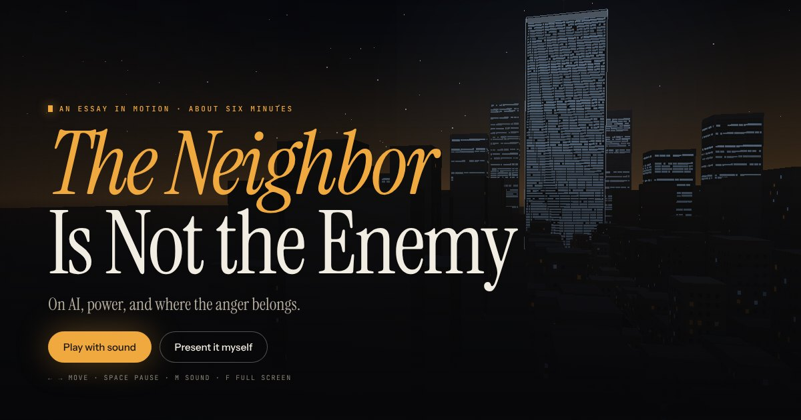

# The Neighbor Is Not the Enemy

A six-minute film about AI, power, and where the anger belongs.

**Watch it:** https://brok3nby-design.github.io/Neighbor/

Best on a laptop or desktop, full screen, with sound on. It also plays on phones.

## What it is

A talk that plays like a short film. A 3D night street carries the argument: one lit window is the neighbor, a glass tower at the end of the street is the giant, and the anger in between gets re-aimed. The music and sound are generated live in the browser.

Everything lives in one file, `index.html`. Download it and open it in any modern browser; it plays offline.

## Controls

| Key | What it does |
| --- | --- |
| Play with sound | Plays the whole film on its own (about six minutes) |
| Present it myself | Waits for you to move on, for presenting live |
| → or click | Next part |
| ← | Previous part |
| Space | Pause |
| M | Sound on or off |
| F | Full screen |
| A | Autoplay on or off |

On a phone, tap the right side of the screen to move on and the left side to go back.

## Credits

- 3D rendering: [three.js](https://threejs.org) r128 (MIT License), bundled in the file.
- Type: Instrument Serif and Instrument Sans by Instrument, JetBrains Mono by JetBrains, all under the SIL Open Font License, embedded in the file.
- Music and sound: synthesized in the browser with the Web Audio API.
